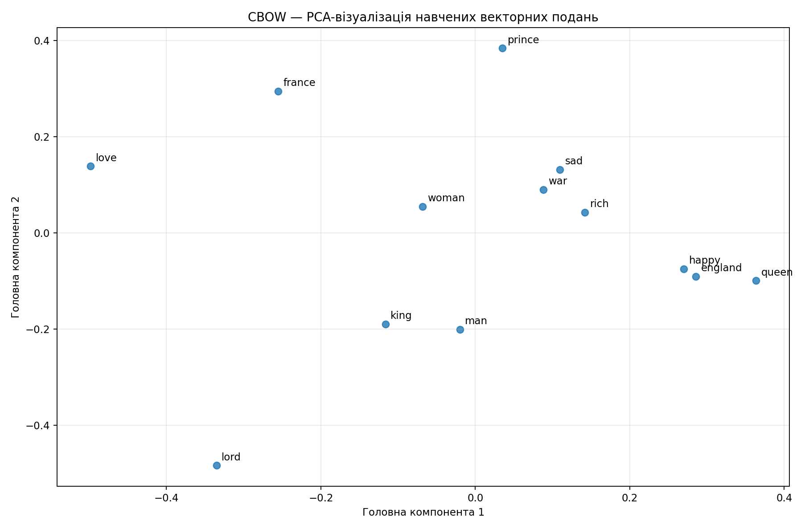
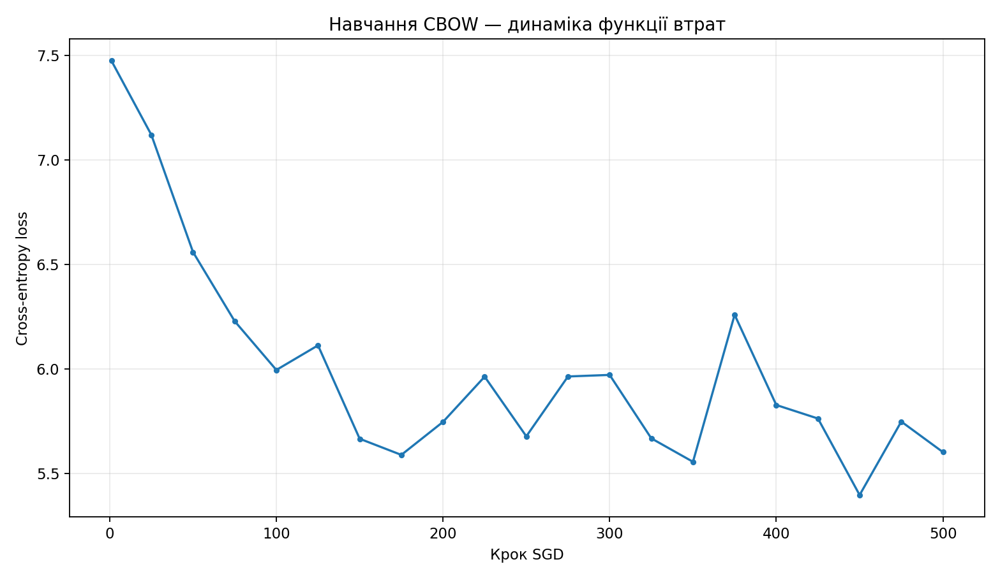

# Лабораторна робота № 8 — звіт

## Тема та мета
Векторні подання слів (Word Embeddings). Побудова та дослідження CBOW.

## Дані та методика
Навчання на локальному корпусі `shakespeare.txt`. Токенізація англомовних слів; для словника використано слова, які зустрічалися щонайменше 3 рази у навчальній частині. Невідомі слова замінено на `<unk>`. Рядки випадково поділено на 90% для навчання і 10% для тесту (seed=42). Контекст: 2 слова ліворуч і 2 праворуч.

## Налаштування моделі
- Архітектура: CBOW зі середнім one-hot контекстом, прихований ReLU, softmax по всьому словнику, крос-ентропія.
- Реалізація: ручне пряме/зворотне поширення на NumPy, мінібатчний SGD.
- Розмірність векторів: **50**. Розмір словника: **1764**.
- Кроків оптимізації: **500**; швидкість навчання **0.35**; batch size **128**.

## Результати
- Речень (рядків) після фільтрації: **5888**; навчальних **5299**, тестових **589**.
- Навчальних вікон: **24121**; тестових: **2641**.
- Втрата першого мінібатча: **7.4746**; останнього: **5.6020**.
- Втрата на відкладеній тестовій вибірці (1000 контекстів): **5.4592**.
- Top-1 accuracy передбачення центрального слова на відкладеній вибірці: **13.30%**.
- Навчання тривало приблизно **1.20 с** у поточному середовищі.

## Дослідження векторів
Таблиця `similar_words.csv` містить найближчі слова за косинусною подібністю; `pca_coordinates.csv` містить двовимірну проєкцію обраних слів. Модель навчається без готових векторів Word2Vec.

## Збереження
Вектори та навчені ваги збережено у `word_embeddings.npz` (`allow_pickle=False`). У блоці Colab є можливість завантажити їх і виконати перевірку.

## Висновок
Реалізовано всі компоненти CBOW, отримано й збережено 50-вимірні подання; PCA і косинусна подібність дозволяють дослідити відношення між словами. Відкладена вибірка та динаміка втрат демонструють результати, але якість складних аналогій обмежена обсягом корпусу і числом кроків навчання. Інтерфейс ipywidgets створено для пошуку сусідів і векторної арифметики.
